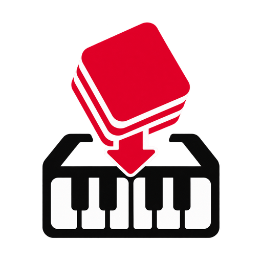

<div align="center">
  
  <h1>Kontakt Drop</h1>
  <p>A drag-and-drop Windows helper for preparing personal Kontakt libraries.</p>

  [Download for Windows](../../releases/latest) · [Report a problem](../../issues)
</div>

## What it does

Kontakt Drop turns the repetitive parts of organizing a full-version Kontakt library into one reviewed workflow:

- scans a dropped folder for NKI, NKM, and NKB instruments;
- checks the folder and instrument names against online results;
- suggests a likely canonical library name without silently renaming anything;
- searches separately for high-resolution 536×264 browser art and 598×98 wallpapers;
- ranks artwork by aspect-ratio accuracy and source resolution;
- provides exact Kontakt reference frames with drag positioning and zoom up to 1200%;
- creates browser artwork and a legacy `wallpaper.png`;
- generates a real NICNT container with a unique SNPID through the bundled MIT-licensed KIDC utility;
- preserves existing NICNT files and can refresh their artwork without overwriting metadata.

## Download

Open the [latest release](../../releases/latest) and download `Kontakt-Drop-1.0.0-portable.exe`. It is portable: no installer is required.

The application is currently unsigned, so Windows SmartScreen may show an **Unknown publisher** warning. Check that you downloaded it from this repository before choosing **More info → Run anyway**.

## Using Kontakt Drop

1. Start Kontakt Drop.
2. Drag the top-level library folder onto the window.
3. Review the detected name, instrument count, and online match.
4. Choose an artwork candidate.
5. Use the **Browser Tile 536×264** and **Wallpaper 598×98** tabs to position the image independently. Drag to move it and use the zoom slider for precise framing.
6. Decide whether the physical folder should be renamed.
7. Select **Prepare Library**.

For non-Player libraries in the official full version of Kontakt 7 or 8, open **Library Browser → cogwheel → Custom Libraries → Add**, then select the prepared folder. You can always load instruments directly from Kontakt's Files browser by opening an `.nki` file.

## Important compatibility limits

Kontakt Drop does **not** activate products, add serial numbers, patch Kontakt, edit the Windows registry, or bypass Native Instruments licensing.

A generated NICNT file does not convert an open-format library into a licensed Kontakt Player library. Player-encoded products still need their legitimate serial and Native Access. Only use Kontakt Drop with libraries and artwork you are authorized to use.

## Privacy and online lookup

Library files remain on the computer. For name and artwork lookup, Kontakt Drop sends only the folder name and a small set of instrument names to Bing search. If the user chooses an online image, that image is downloaded to create the local Kontakt artwork.

Online search can change or stop working when search-engine markup changes. Local artwork remains available as a fallback.

## Build from source

Requirements: Windows 10/11, Node.js 22 or newer, and pnpm 11.

```powershell
git clone https://github.com/spapian/kontakt-drop.git
cd kontakt-drop
pnpm install --config.blockExoticSubdeps=false
pnpm test
pnpm run dev
```

Create the portable executable:

```powershell
pnpm run build
```

The result is written to `dist/Kontakt-Drop-1.0.0-portable.exe`. GitHub Actions also runs the test and build workflow for every pull request and publishes release assets for version tags.

## Project structure

- `src/main.cjs` — Electron main process, search, metadata generation, and artwork export.
- `src/renderer/` — drag-and-drop interface and artwork positioning editor.
- `src/artwork.cjs` — deterministic Kontakt artwork compositor.
- `src/core.cjs` — library scanning, matching, SNPID parsing, and image ranking.
- `backend/kidc/` — bundled KIDC runtime and its original license.
- `test/` — Node test suite.

## Development and licensing

The Kontakt Drop source code is available under the [MIT License](LICENSE). Bundled and development dependencies retain their own licenses; see [third-party notices](THIRD_PARTY_NOTICES.md).

Kontakt and Native Instruments are trademarks of Native Instruments GmbH. This independent project is not affiliated with or endorsed by Native Instruments.
